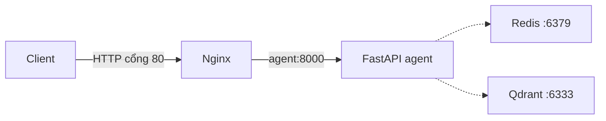

# Day 14 Lab — Mission Answers

## Part 1 · Localhost vs Production

### Exercise 1.1 · Các vấn đề trong bản develop

1. **Thông tin nhạy cảm được gán trực tiếp trong mã nguồn.** `OPENAI_API_KEY` và `DATABASE_URL` là chuỗi cố định. Nếu đưa thông tin thật vào các biến này, người có quyền đọc repo hoặc lịch sử commit có thể thấy chúng. Việc đổi thông tin kết nối cũng buộc phải sửa code. [develop/app.py, dòng 17](01-localhost-vs-production/develop/app.py#L17)
2. **Log in trực tiếp key và nội dung request.** Các lệnh `print()` ghi câu hỏi, key và câu trả lời ra stdout. Với dữ liệu thật, log có thể làm lộ thông tin nhạy cảm. Các dòng text này cũng thiếu trường cố định để hệ thống thu thập log lọc theo sự kiện. [develop/app.py, dòng 33](01-localhost-vs-production/develop/app.py#L33)
3. **Server chỉ lắng nghe trên `localhost`.** Trong container, `localhost` là địa chỉ loopback của chính container. Reverse proxy hoặc máy bên ngoài cần agent lắng nghe trên giao diện mạng có thể truy cập được. [develop/app.py, dòng 51](01-localhost-vs-production/develop/app.py#L51)
4. **Cổng `8000` được đặt cố định.** Nếu nền tảng cấp cổng khác qua biến `PORT`, router sẽ gửi request đến cổng mà app chưa mở. [develop/app.py, dòng 52](01-localhost-vs-production/develop/app.py#L52)
5. **Chế độ tự nạp lại luôn bật.** `reload=True` hữu ích khi sửa code trên máy cá nhân. Trình theo dõi file có thể khởi động lại worker khi file thay đổi, làm gián đoạn phục vụ nếu dùng cấu hình này khi triển khai. [develop/app.py, dòng 53](01-localhost-vs-production/develop/app.py#L53)
6. **Thiếu endpoint liveness và readiness riêng.** App chỉ khai báo `GET /` và `POST /ask`. Nền tảng cần probe riêng để quyết định process còn sống và instance đã sẵn sàng nhận traffic hay chưa. [develop/app.py, dòng 25](01-localhost-vs-production/develop/app.py#L25)
7. **App chưa có hook vòng đời riêng.** `FastAPI(...)` dùng vòng đời mặc định. Khi agent cần quản lý kết nối hoặc tài nguyên, app cần điểm khởi tạo khi startup và điểm dọn dẹp khi shutdown. [develop/app.py, dòng 13](01-localhost-vs-production/develop/app.py#L13)

### Exercise 1.2 · Chạy bản develop và gọi `/ask`

Lần chạy kiểm chứng dùng Ubuntu 24.04 trên WSL2. Để tái hiện từ gốc repo, mở terminal thứ nhất và chạy các lệnh sau.

```bash
cd 01-localhost-vs-production/develop
python3 -m venv .venv
source .venv/bin/activate
python -m pip install -r requirements.txt
python app.py
```

Từ terminal thứ hai, gửi request.

```bash
curl -sSi -X POST 'http://127.0.0.1:8000/ask?question=Docker'
```

Trích phản hồi thực tế.

```http
HTTP/1.1 200 OK
content-type: application/json

{"answer":"Container là cách đóng gói app để chạy ở mọi nơi. Build once, run anywhere!"}
```

FastAPI lấy `question` từ query string vì handler khai báo `ask_agent(question: str)`. Mã `200` và trường `answer` xác nhận route nhận được câu hỏi và trả lời qua mock LLM. [develop/app.py, dòng 30](01-localhost-vs-production/develop/app.py#L30)

### Exercise 1.3 · So sánh develop và production

| Hạng mục | Develop | Production | Vì sao quan trọng khi triển khai |
| --- | --- | --- | --- |
| Cấu hình và secret | Key và thông tin kết nối là chuỗi trong code. | `Settings` đọc biến môi trường. Khi `ENVIRONMENT=production`, `validate()` yêu cầu có `AGENT_API_KEY`. [production/config.py, dòng 26](01-localhost-vs-production/production/config.py#L26) | Dùng cùng mã nguồn ở nhiều môi trường và quản lý thông tin nhạy cảm qua cấu hình triển khai. |
| Địa chỉ, cổng và reload | `localhost:8000` và `reload=True`. | `HOST` mặc định là `0.0.0.0`, `PORT` đọc từ môi trường và `DEBUG` mặc định là `false`. Uvicorn dùng các giá trị này khi khởi động. [production/config.py, dòng 17](01-localhost-vs-production/production/config.py#L17) · [production/app.py, dòng 194](01-localhost-vs-production/production/app.py#L194) | Container nhận được request từ proxy, app nghe đúng cổng nền tảng cấp và chế độ reload do môi trường quyết định. |
| Health và readiness | Có route `/` trả lời chào. | `/health` báo trạng thái và uptime. `/ready` dựa vào `is_ready` và trả `503` khi cờ là `False`. [production/app.py, dòng 135](01-localhost-vs-production/production/app.py#L135) · [production/app.py, dòng 152](01-localhost-vs-production/production/app.py#L152) | Liveness giúp kiểm tra process. Readiness giúp load balancer quyết định khi nào gửi traffic vào instance. |
| Logging | `print()` chứa nội dung câu hỏi, câu trả lời và key. | Dùng `logging` với thời gian và level. Sự kiện request và response ghi tên sự kiện cùng độ dài câu hỏi hoặc câu trả lời. [production/app.py, dòng 28](01-localhost-vs-production/production/app.py#L28) · [production/app.py, dòng 111](01-localhost-vs-production/production/app.py#L111) | Có trường để tìm và lọc log, đồng thời hạn chế ghi nội dung request và secret vào log. |
| Shutdown | App dùng vòng đời mặc định của FastAPI và Uvicorn. | FastAPI gắn `lifespan`, đặt `is_ready=True` khi đã khởi động và đổi sang `False` khi shutdown. Lifespan cung cấp vị trí dọn tài nguyên. [production/app.py, dòng 39](01-localhost-vs-production/production/app.py#L39) | App có thể ghi nhận vòng đời và đóng kết nối trong quá trình tắt an toàn. |
| Dữ liệu gửi vào `/ask` | `question` là query parameter. | Đọc `question` từ JSON body và trả `422` nếu thiếu hoặc rỗng. [production/app.py, dòng 102](01-localhost-vs-production/production/app.py#L102) | Client cần gửi dữ liệu đúng hợp đồng của phiên bản đang chạy. |

Khi chạy bản production ở môi trường `development` với `DEBUG=false` trên cổng `8000`, hai probe đều trả `200 OK` sau khi app khởi động. `GET /health` có `"status":"ok"` và `GET /ready` trả `{"ready":true}`.

Chi tiết về log của bản mẫu. Các event có trường riêng, nhưng formatter chèn `%(message)s` thẳng vào chuỗi JSON. Nếu message đã chứa dấu nháy từ `json.dumps`, dòng log có thể không parse được dưới dạng JSON. [production/app.py, dòng 30](01-localhost-vs-production/production/app.py#L30)

## Part 2 · Docker Containerization

Môi trường kiểm chứng là Ubuntu 24.04 trên WSL2, Docker Engine `29.2.1`, nền tảng `linux/amd64`.

### Exercise 2.1 · Đọc Dockerfile bản develop

1. **Base image.** `FROM python:3.11` cung cấp Python 3.11 cùng môi trường hệ điều hành để cài và chạy ứng dụng. [Dockerfile develop, dòng 8](02-docker/develop/Dockerfile#L8)
2. **Thư mục làm việc.** `WORKDIR /app` đặt `/app` làm thư mục mặc định bên trong image cho các lệnh như `RUN`, `COPY` với đích tương đối và `CMD` khi container khởi động. [Dockerfile develop, dòng 11](02-docker/develop/Dockerfile#L11)
3. **Thứ tự `COPY`.** Dockerfile chép `requirements.txt` rồi cài packages trước khi chép `app.py`. Khi chỉ sửa `app.py`, Docker có thể dùng lại cache của bước cài packages nếu tệp yêu cầu và các bước trước đó giữ nguyên. [Dockerfile develop, dòng 14](02-docker/develop/Dockerfile#L14)
4. **`CMD` và `ENTRYPOINT`.** `CMD ["python", "app.py"]` là lệnh mặc định của image develop. Tham số sau tên image trong `docker run` có thể thay giá trị `CMD`. `ENTRYPOINT` xác định chương trình khởi chạy và có thể nhận `CMD` làm danh sách đối số mặc định. [Dockerfile develop, dòng 30](02-docker/develop/Dockerfile#L30)

### Exercise 2.2 · Build, chạy và gọi container develop

Build từ gốc repo để Docker tìm được mã nguồn ở `02-docker/develop/` và mock LLM ở `utils/`.

```bash
docker build -f 02-docker/develop/Dockerfile -t my-agent:develop .
docker run -d --rm --name day14-cp2-demo -p 127.0.0.1::8000 my-agent:develop
cp2_develop_addr=$(docker port day14-cp2-demo 8000/tcp)
```

Docker cấp `127.0.0.1:50341` cho cổng `8000/tcp` trong lượt kiểm chứng. Khi tái chạy, xem `docker logs day14-cp2-demo` và chờ `Application startup complete` rồi gọi API theo địa chỉ của lượt đó.

```bash
curl -i "http://$cp2_develop_addr/health"
curl -i -X POST "http://$cp2_develop_addr/ask?question=Docker"
```

`GET /health` trả `HTTP/1.1 200 OK` với `{"status":"ok","uptime_seconds":0.3,"container":true}`. `POST /ask` trả `HTTP/1.1 200 OK` và body sau.

```json
{"answer":"Container là cách đóng gói app để chạy ở mọi nơi. Build once, run anywhere!"}
```

Container kiểm chứng đã dừng sau khi lấy kết quả. Khi tự chạy bằng tên trong ví dụ, dùng `docker stop day14-cp2-demo` để dừng container.

### Exercise 2.3 · Multi-stage build và dung lượng image

Builder dùng `python:3.11-slim`, cài `gcc` và `libpq-dev` rồi cài dependencies Python vào `/root/.local`. Runtime bắt đầu từ một stage `python:3.11-slim` riêng, nhận dependencies từ builder và mã nguồn cần chạy, rồi khởi động với user `appuser`. Image cuối gọn hơn nhờ base slim và các layer cài công cụ build chỉ nằm trong builder. [Dockerfile production, dòng 16](02-docker/production/Dockerfile#L16) · [Dockerfile production, dòng 36](02-docker/production/Dockerfile#L36)

```bash
docker build -f 02-docker/production/Dockerfile -t my-agent:advanced .
docker images my-agent
docker image inspect --format '{{index .RepoTags 0}} {{.Size}}' my-agent:develop my-agent:advanced
```

So sánh trên cùng chỉ số `CONTENT SIZE` từ `docker images`. Dùng `.Size` theo byte để tính phần trăm trước khi làm tròn.

| Image | `CONTENT SIZE` hiển thị | Số byte từ `.Size` | Dung lượng theo MB |
| --- | --- | ---: | ---: |
| `my-agent:develop` | `426MB` | 426320080 | 426,32 |
| `my-agent:advanced` | `57.4MB` | 57409066 | 57,41 |

Bản `advanced` giảm **368,91 MB**, tương đương **86,53%** theo công thức `(426320080 - 57409066) / 426320080 × 100`. Mỗi MB trong bảng bằng 1.000.000 byte.

### Exercise 2.4 · Docker Compose và kiểm tra qua Nginx



Nginx chuyển request vào `agent:8000` trên mạng Docker. Hai đường nét đứt thể hiện dependency trong Compose. Agent khởi động sau khi Redis và Qdrant đạt health check. `/ask` của ví dụ lấy câu trả lời từ mock LLM. [Compose production, dòng 22](02-docker/production/docker-compose.yml#L22) · [Nginx, dòng 15](02-docker/production/nginx/nginx.conf#L15) · [Agent production, dòng 57](02-docker/production/main.py#L57)

Chạy từ gốc repo. `.env.local` dùng cho Compose và có thể để trống trong bài này.

```bash
cd 02-docker/production
touch .env.local
docker compose -p k5-day14-cp2 up -d --build --wait
docker compose -p k5-day14-cp2 ps
curl -i http://127.0.0.1:80/health
curl -i -X POST http://127.0.0.1:80/ask \
  -H 'Content-Type: application/json' \
  -d '{"question":"Docker"}'
docker compose -p k5-day14-cp2 down
```

| Kiểm tra thực tế | Kết quả |
| --- | --- |
| Trạng thái Compose | `agent`, `redis`, `qdrant` ở trạng thái `healthy`. `nginx` ở trạng thái `Up` và xuất cổng HTTP `80`. |
| `GET /health` qua Nginx | `HTTP/1.1 200 OK`, `Server: nginx`, JSON có `"status":"ok"` và `"version":"2.0.0"`. |
| `POST /ask` qua Nginx | `HTTP/1.1 200 OK`, `Server: nginx`, JSON có `answer` với câu trả lời mock về Docker. |

Header `Server: nginx` cùng mã `200` xác nhận request đã đi qua gateway. Container thử nghiệm và stack `k5-day14-cp2` đã được dừng sau khi kiểm chứng.

## Part 3 · Cloud Deployment (CP6)

### Exercise 3.1 · Triển khai trên Railway

Railway CLI đã xác thực. API Railway trả về gói `HOBBY` cho workspace hiện tại, nên mình chọn Render Free theo mục 5 của luật lab. [Luật lab](RULES.md#5-secret-tài-khoản-cloud-và-dữ-liệu) · [Cấu hình Railway của agent](06-lab-complete/railway.toml)

### Exercise 3.2 · Triển khai trên Render và so sánh cấu hình

Agent `06-lab-complete/` chạy trên Render Free cùng Key Value tương thích Redis tại Singapore. Tại URL công khai, `GET /health` và `GET /ready` lần lượt trả `200` và `200`. `POST /ask` trả `401` khi thiếu key và `200` với key đúng. [URL agent](https://day14-cp6-agent.onrender.com) · [Thông tin triển khai và kết quả](DEPLOYMENT.md)

| Hạng mục | Railway của agent Part 6 | Blueprint Render mẫu trong Part 3 |
| --- | --- | --- |
| Phạm vi cấu hình | `railway.toml` đặt cách build và health check cho service agent. Redis được thêm như một service riêng cùng project. | `render.yaml` dùng danh sách `services` để mô tả web service và Redis cache trong cùng Blueprint. |
| Build và khởi động | `builder = "DOCKERFILE"` dùng image multi-stage. `CMD` của Dockerfile khởi động Uvicorn theo biến `PORT`. | Mẫu dùng `runtime: python`, `buildCommand` để cài dependencies và `startCommand` để chạy Uvicorn theo `PORT`. |
| Health check | `healthcheckPath = "/health"` xác định endpoint Railway kiểm trước khi chuyển traffic vào deployment mới. | `healthCheckPath: /health` khai báo cùng endpoint trong cấu hình web service. |
| Secret và Redis | Agent nhận `AGENT_API_KEY` từ biến của service và dùng `REDIS_URL` tham chiếu Redis trong project. | Mẫu dùng `generateValue: true` cho biến cần sinh tự động và `sync: false` cho biến nhập ngoài Git. Agent cần giá trị `REDIS_URL` trỏ tới Redis của môi trường triển khai. |

Railway build từ Dockerfile đã qua bộ chấm CP5. Blueprint Render mô tả hạ tầng theo YAML và trong ví dụ này dùng runtime Python của nền tảng. [Railway của Part 6](06-lab-complete/railway.toml) · [Dockerfile Part 6](06-lab-complete/Dockerfile) · [Blueprint Render mẫu](03-cloud-deployment/render/render.yaml) · [Redis trên Railway](https://docs.railway.com/databases/redis)

Blueprint Render Free cho CP6 khai báo web service dùng Dockerfile của Part 6 và Key Value tương thích Redis tại cùng region. `REDIS_URL` dùng địa chỉ nội bộ của Key Value và `AGENT_API_KEY` lấy từ biến môi trường của web service. [Blueprint Render của Part 6](06-lab-complete/render.yaml) · [Cấu hình Blueprint](https://render.com/docs/blueprint-spec)

### Exercise 3.3 · Pipeline Cloud Run

1. Bước `test` dùng Python 3.11, cài dependencies và gọi `pytest`.
2. Bước `build` tạo Docker image và gắn tag theo `$COMMIT_SHA` cùng `latest`.
3. Bước `push` đẩy cả hai tag lên registry `gcr.io/$PROJECT_ID/ai-agent` của ví dụ.
4. Bước `deploy` dùng image theo commit để triển khai lên Cloud Run. `service.yaml` mô tả tài nguyên, số instance, concurrency, probe và tham chiếu secret của service.

[Pipeline Cloud Build](03-cloud-deployment/production-cloud-run/cloudbuild.yaml) · [Cấu hình Cloud Run](03-cloud-deployment/production-cloud-run/service.yaml)

## Part 4 · API Gateway & Security (CP3)

Lượt kiểm chứng chạy hai app trên Ubuntu WSL2. App `develop` lắng nghe tại `127.0.0.1:39881`, app `production` tại `127.0.0.1:55441`. Mỗi app dùng khóa thử riêng cho lượt chạy.

### Exercise 4.1 · Kiểm tra API key

`verify_api_key()` đọc header `X-API-Key` và so sánh với biến `AGENT_API_KEY` khi xử lý `POST /ask`. Thiếu header trả `401`, key sai trả `403`, key đúng cho phép xử lý request. Khi đổi key, cập nhật biến môi trường, khởi động lại app và cập nhật key tương ứng ở client. [develop/app.py, dòng 35](04-api-gateway/develop/app.py#L35) · [develop/app.py, dòng 67](04-api-gateway/develop/app.py#L67)

Các request kiểm tra đều gửi JSON `{"question":"Docker"}`. Trích kết quả `curl -i` thực tế.

```http
HTTP/1.1 401 Unauthorized
content-type: application/json

{"detail":"Missing API key. Include header: X-API-Key: <your-key>"}
```

```http
HTTP/1.1 403 Forbidden
content-type: application/json

{"detail":"Invalid API key."}
```

```http
HTTP/1.1 200 OK
content-type: application/json

{"question":"Docker","answer":"Container là cách đóng gói app để chạy ở mọi nơi. Build once, run anywhere!"}
```

Để tái hiện trong `04-api-gateway/develop`, cài `requirements.txt` rồi chạy `AGENT_API_KEY=cp3-local-demo python -m uvicorn app:app --host 127.0.0.1 --port 39881`. Gọi `POST /ask` lần lượt với header bị thiếu, key sai và `X-API-Key: cp3-local-demo`.

### Exercise 4.2 · Lấy JWT và gọi API

`POST /auth/token` xác thực tài khoản demo `student`. Server ký token bằng `HS256`, kèm định danh người dùng (`sub`), vai trò (`role`) và thời điểm hết hạn (`exp`). Client gửi `Authorization: Bearer <token>` khi gọi `/ask`. `verify_token()` kiểm tra chữ ký và thời hạn trước khi dùng danh tính và vai trò trong request. [production/app.py, dòng 105](04-api-gateway/production/app.py#L105) · [production/auth.py, dòng 35](04-api-gateway/production/auth.py#L35) · [production/auth.py, dòng 46](04-api-gateway/production/auth.py#L46)

Gọi `/ask` khi thiếu token trả `401 Unauthorized` với header `www-authenticate: Bearer`. Gọi `/auth/token` với tài khoản demo trả kết quả dưới đây. Token và phần gợi ý chứa đầu token đã được che.

```http
HTTP/1.1 200 OK

{"access_token":"<redacted>","token_type":"bearer","expires_in_minutes":60}
```

### Exercise 4.3 · Kiểm tra rate limit

Bộ giới hạn dùng **sliding window** 60 giây. Mỗi user có một `deque` chứa thời điểm các request được nhận. Sau khi bỏ timestamp ngoài cửa sổ, nếu số request đã đạt ngưỡng, app trả `429` và `Retry-After`. Tài khoản vai trò `user` có hạn mức **10 request/phút**, còn vai trò `admin` có hạn mức riêng **100 request/phút**. Mã demo lưu timestamp trong RAM của process. [rate_limiter.py, dòng 31](04-api-gateway/production/rate_limiter.py#L31) · [rate_limiter.py, dòng 86](04-api-gateway/production/rate_limiter.py#L86) · [production/app.py, dòng 140](04-api-gateway/production/app.py#L140)

Gửi 20 request liên tiếp bằng cùng JWT của `student`. Request 1–10 trả `200`, request 11–20 trả `429`. Request đầu trả `usage.requests_remaining=9`. Trích output của request thứ 11.

```http
HTTP/1.1 429 Too Many Requests
content-type: application/json
retry-after: 59
x-ratelimit-limit: 10
x-ratelimit-remaining: 0

{"detail":{"error":"Rate limit exceeded","limit":10,"window_seconds":60,"retry_after_seconds":59}}
```

Để tái hiện, mở app `production` từ `04-api-gateway/production` sau khi cài `requirements.txt`. Ví dụ chạy qua `python -m uvicorn app:app --host 127.0.0.1 --port 55441`. Gửi vòng lặp trong terminal thứ hai khi tài khoản `student` còn đủ lượt trong cửa sổ hiện tại.

```bash
cp3_base=http://127.0.0.1:55441
cp3_token=$(curl -fsS -X POST "$cp3_base/auth/token" \
  -H 'Content-Type: application/json' \
  -d '{"username":"student","password":"demo123"}' |
  python3 -c 'import json, sys; print(json.load(sys.stdin)["access_token"])')

for i in $(seq 1 20); do
  curl -sS -o /dev/null -w '%{http_code}\n' \
    -H "Authorization: Bearer $cp3_token" \
    -H 'Content-Type: application/json' \
    -d '{"question":"Docker"}' "$cp3_base/ask"
done
```

### Exercise 4.4 · Cách cost guard bảo vệ ngân sách

Luồng xử lý là xác thực JWT → kiểm tra rate limit → kiểm tra ngân sách → gọi mock LLM → ghi số token và chi phí. Mã demo đặt ngân sách mỗi user `$1/ngày` và ngưỡng tổng `$10`. Khi hết ngân sách user, `check_budget()` có nhánh trả `402`. Khi chạm ngưỡng tổng, nhánh tương ứng trả `503`. [production/app.py, dòng 140](04-api-gateway/production/app.py#L140) · [cost_guard.py, dòng 59](04-api-gateway/production/cost_guard.py#L59)

Chi phí mock bằng `input_tokens / 1000 × giá input + output_tokens / 1000 × giá output`. `GET /me/usage` sau vòng lặp trả `200 OK`, ghi **10 request**, **20 input token**, **300 output token**, `cost_usd=0.000183` và `budget_remaining_usd=0.999817`. Vì bộ giới hạn chặn trước bước gọi mock, 10 request `429` không nằm trong usage. Trường `budget_remaining_usd` ở phản hồi `/ask` hiện lấy giá trị `usage.total_cost_usd`. Số dư ở đây được đối chiếu từ `/me/usage`, nơi lấy ngân sách trừ chi phí. [production/app.py, dòng 153](04-api-gateway/production/app.py#L153) · [cost_guard.py, dòng 113](04-api-gateway/production/cost_guard.py#L113)

Với yêu cầu **`$10/user/tháng`** của Exercise 4.4, mỗi user có khóa Redis `budget:{user_id}:{YYYY-MM}` theo tháng UTC. Trước khi gọi LLM, ước tính chi phí và kiểm tra `đã dùng + dự trữ ≤ $10`. Kiểm tra và ghi phần dự trữ trong cùng thao tác nguyên tử để nhiều instance dùng chung ngân sách. Trả `402` khi tổng vượt ngưỡng. Sau khi gọi, đối soát phần dự trữ theo token thực tế và hoàn lại phần dự trữ nếu lượt gọi không phát sinh chi phí. Sang tháng mới, app đọc khóa của tháng mới và khóa cũ tự hết hạn theo TTL.

Rate limit giới hạn số request trong một khoảng thời gian. Cost guard giới hạn số tiền dựa trên lượng token, kể cả khi một số ít request có prompt hoặc phản hồi dài.

## Part 5 · Scaling & Reliability (CP4)

### Exercise 5.1 · Health checks

Agent develop trả `200` ở cả `/health` và `/ready` sau startup. Trong bản Compose, khi tạm dừng Redis, `/health` trả `200` với `status="degraded"` còn `/ready` trả `503`. Sau khi Redis chạy lại, `/ready` về `200`. Mình đặt timeout kết nối và đọc Redis là 1 giây sau khi lượt đầu chờ quá lâu. Liveness cho biết tiến trình còn đáp ứng, còn readiness cho biết có thể nhận công việc cần Redis. [Agent develop](05-scaling-reliability/develop/app.py) · [Probe trong agent production](05-scaling-reliability/production/app.py)

### Exercise 5.2 · Graceful shutdown

Chạy agent bằng `python app.py` theo lab, gửi hai request rồi gửi SIGTERM trong lúc chúng còn đang xử lý. Hai request trả `200` sau 3.02 giây và 6.02 giây. Uvicorn ghi `Waiting for connections to close`, sau đó `Application shutdown complete` và tiến trình thoát mã `0`. Mock LLM đồng bộ giữ event loop khi gọi nên hai request trong lượt này hoàn thành lần lượt. Lượt thử khởi động bằng `python -m uvicorn app:app` nhận SIGTERM nhưng chưa thu được shutdown hoàn tất trong 12 giây. Entry point `python app.py` đăng ký handler mẫu trước khi Uvicorn bắt đầu quản lý tín hiệu. [Mã shutdown](05-scaling-reliability/develop/app.py)

### Exercise 5.3 · Stateless design

Agent lưu lịch sử theo `session_id` trong Redis, với TTL một giờ sau lần ghi. Replica nhận request tiếp theo dùng cùng ID để đọc lịch sử. Nếu lưu trong RAM, mỗi replica có bản lịch sử riêng và trạng thái của replica mất khi tiến trình bị thay thế. [Lưu phiên trong Redis](05-scaling-reliability/production/app.py)

### Exercise 5.4 và 5.5 · Cân bằng tải và kiểm thử phiên chat

Project `k5-day14-scaling` chạy ba replica. `test_stateless.py` đi qua Nginx trong mạng Compose, gửi năm lượt hỏi và nhận kết quả sau.

```text
Request 1: instance-b806e4
Request 2: instance-d5887f
Request 3: instance-78ca0b
Request 4: instance-b806e4
Request 5: instance-d5887f
Total messages: 10
```

Ở lượt failover riêng, mình dừng `instance-b806e4` sau câu đầu. Câu tiếp theo dùng cùng `session_id` được `instance-d5887f` xử lý, storage báo `redis` và lịch sử có đủ bốn tin nhắn. Trong lượt kiểm thử, Compose CP4 dùng cổng host `8081` để chạy cạnh CP8 và đã được dừng sau đó. Cấu hình Compose đọc `.env.local` khi tệp có mặt. [Compose CP4](05-scaling-reliability/production/docker-compose.yml) · [Cấu hình Nginx](05-scaling-reliability/production/nginx.conf) · [Script stateless](05-scaling-reliability/production/test_stateless.py)

## Part 6 · Final Project (CP5)

Đã chạy `python check_production_ready.py` ở chế độ đầy đủ trong `06-lab-complete/` trên Ubuntu 24.04 WSL2 với Docker Engine `29.2.1` và Redis tạm của bộ chấm.

```text
  📋 Checklist Deliverable
     ✅ Dockerfile (multi-stage, < 500 MB)
     ✅ docker-compose.yml (agent + redis)
     ✅ .dockerignore
     ✅ Health check endpoint (GET /health)
     ✅ Readiness endpoint (GET /ready)
     ✅ API Key authentication
     ✅ Rate limiting
     ✅ Cost guard
     ✅ Config từ environment variables
     ✅ Structured logging
     ✅ Graceful shutdown
     ✅ Public URL ready (Railway / Render config)
----------------------------------------------------------------
  Result: 12/12 tiêu chí đạt · 41/41 checks passed
  🎉 PASS 12/12 — PRODUCTION READY! Deploy nào!
```

**Kết quả thực tế.** Image được bộ chấm đo là **63 MB**. Khi nhận `SIGTERM` trong lúc xử lý, request vẫn trả `200` và process thoát với code `0`. Bài thử `docker stop` hoàn tất trong **0,8 giây** với exit code `0`.

Kiểm tra qua Docker Compose với cổng tạm `38431` cũng xác nhận các hành vi sau.

| Kiểm tra | Kết quả |
| --- | --- |
| `/ask` với key thiếu hoặc sai | `401` |
| `/ask` với câu hỏi rỗng và key đúng | `422` |
| 12 request cùng API key gửi đồng thời | 10 lần `200` và 2 lần `429` |
| Dừng Redis | `/health` vẫn `200`, `/ready` và `/ask` trả `503` |
| Khởi động lại Redis | `/ready` trở lại `200` |

Redis giữ cửa sổ rate limit 60 giây dùng chung cho hai worker. Bộ chấm xác nhận agent trả `429` sau 5 lượt thành công với hạn mức kiểm thử và vẫn trả `429` sau khi restart agent. Cost guard dùng Redis để dự trữ khoản chi phí trước khi gọi mock LLM, sau đó đối soát theo token. Khi bộ chấm đặt ngân sách dưới chi phí một lượt gọi, `/ask` trả `402`. [Rate limiter](06-lab-complete/app/rate_limiter.py) · [Cost guard](06-lab-complete/app/cost_guard.py)

Cấu hình deploy dùng `railway.toml`, còn command trong Dockerfile nhận `PORT` từ môi trường. Tiêu chí Public URL ready ở CP5 kiểm tra cấu hình. CP6 là mốc triển khai và xác minh URL public. [Hướng dẫn chạy và chấm](06-lab-complete/README.md)

## AI log

- **Yêu cầu CP2.** Mình nhờ AI chạy tự động Exercise 2.1–2.4 và ghi kết quả thực tế.
- **Hỗ trợ nhận được.** AI đối chiếu Dockerfile, build hai image, đo dung lượng, gọi API của container develop và của stack qua Nginx trên WSL2, rồi cập nhật bài làm.
- **Phần mình đã làm.** Mình đã tự thử lệnh build và chạy `newgrp docker` khi terminal thiếu quyền. Các số đo và phản hồi HTTP ở Part 2 lấy từ lượt chạy kiểm chứng của AI trên máy. Các lệnh trong từng mục dùng để mình tái hiện kết quả.

### CP3 · API Security

- **Yêu cầu.** Mình nhờ AI lên các việc cần làm, chạy kiểm chứng CP3 và ghi kết quả.
- **Hỗ trợ nhận được.** AI chạy hai app local, lấy JWT demo, kiểm tra API key, gửi vòng lặp rate limit và đọc `/me/usage`. Kết quả HTTP trong Part 4 đến từ lượt chạy đó. Phần giải thích cost guard được đối chiếu với mã nguồn.
- **Cách tự kiểm tra.** Chạy vòng lặp trong Exercise 4.3 bằng tài khoản demo và đối chiếu `200`, `429` với header `Retry-After` của lượt chạy của mình.

### CP5 · Final Project

- **Yêu cầu.** Mình nhờ AI hoàn thiện CP5 và chạy bộ chấm.
- **Hỗ trợ nhận được.** AI hoàn thiện agent, đọc cấu hình từ env, dùng Redis cho rate limit và cost guard, chuẩn bị image, Compose và cấu hình Railway. AI chạy bộ chấm đầy đủ cùng bài thử Compose trên máy. Kết quả thực tế được ghi ở Part 6.
- **Cách tự kiểm tra.** Chạy lại `python check_production_ready.py` trong Ubuntu WSL2. Đối chiếu `/health` và `/ready` khi Redis dừng, kết quả `429` sau restart và log khi nhận `SIGTERM`.

### CP6 · Cloud Deployment

- **Yêu cầu.** Mình nhờ AI lên kế hoạch và thực hiện CP6.
- **Hỗ trợ nhận được.** AI kiểm tra gói `HOBBY` của workspace Railway, tạo nhánh triển khai riêng, triển khai web service và Key Value trên Render Free, rồi chạy bốn phép thử HTTP. AI đối chiếu cấu hình Railway và Render rồi đọc hai file mẫu Cloud Run để mô tả pipeline.
- **Cách tự kiểm tra.** Chạy lại bốn lệnh trên URL Render theo `DEPLOYMENT.md` và lưu ảnh bằng chứng cho lượt kiểm thử của mình.

### CP7 · Benchmark local

- **Yêu cầu.** Mình nhờ AI thực hiện CP7 và điền báo cáo từ số đo local.
- **Hỗ trợ nhận được.** AI thêm histogram độ dài câu hỏi và kiểm tra `/metrics`, chạy bảy lượt load test và ba lượt eval trong Ubuntu WSL2. AI đọc hai trường `missing_keywords` rồi bổ sung tài liệu JWT và HPA vào knowledge base.
- **Cách tự kiểm tra.** Đối chiếu từng hàng trong báo cáo với mười file JSON. Chạy lại eval cuối theo lệnh trong báo cáo để xác nhận 23/23 câu và 0 regression. [Báo cáo benchmark](BENCHMARK_REPORT.md)

### CP4 · Scaling & Reliability

- **Yêu cầu.** Mình nhờ AI chạy các checkpoint còn lại, gồm phần kiểm chứng CP4.
- **Hỗ trợ nhận được.** AI kiểm tra hai probe và SIGTERM, chạy test stateless qua ba replica, thử dừng replica đã phục vụ lượt đầu và đặt timeout Redis sau khi probe chờ quá lâu.
- **Cách tự kiểm tra.** So kết quả `served_by` giữa các lượt trong cùng phiên, đếm tin nhắn trong history và gọi lại `/ready` sau khi Redis phục hồi.

### CP8 · Observability và benchmark scale

- **Yêu cầu.** Mình nhờ AI chạy các phần còn lại, gồm stack observability, benchmark scale và chuẩn bị file nộp.
- **Hỗ trợ nhận được.** AI sửa đường dẫn package của user runtime, chạy Prometheus rule test và Locust headless, xác minh số replica qua mẫu scrape, lấy số đo Grafana và thời gian ba cảnh báo, rồi đối chiếu hai trace với log agent.
- **Cách tự kiểm tra.** So các dòng `Aggregated` ở hai CSV với bảng scale, mở trace Jaeger theo `trace_id`, đối chiếu event `exception` với log và lưu ảnh khi hai alert cùng `firing`. [Báo cáo benchmark](BENCHMARK_REPORT.md)
